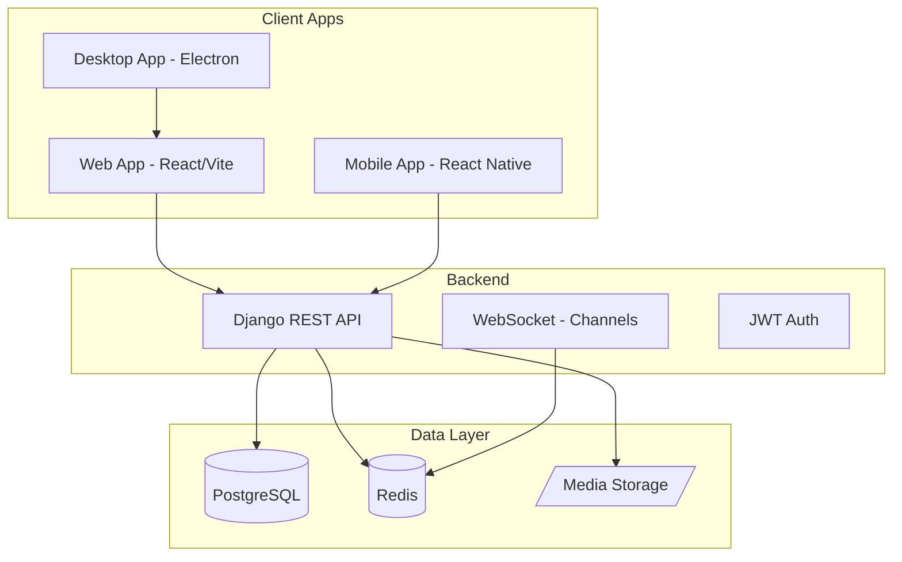
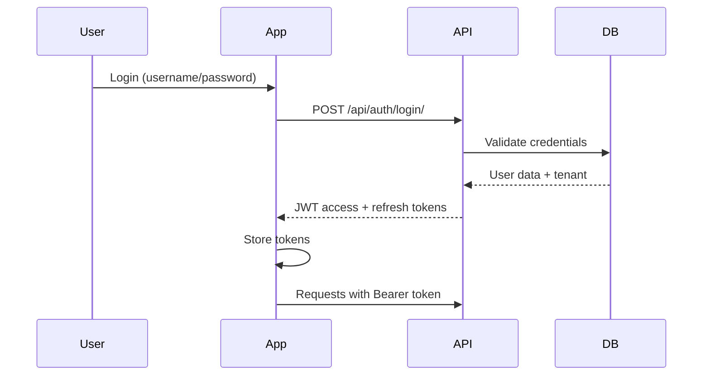
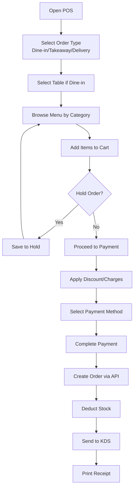
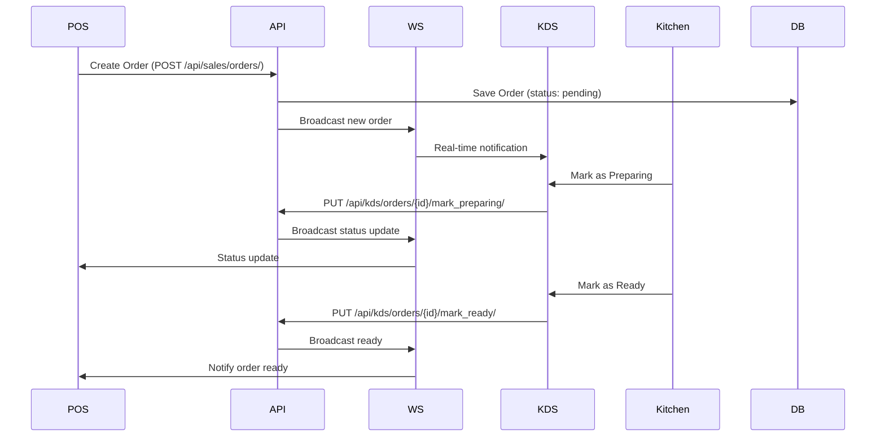
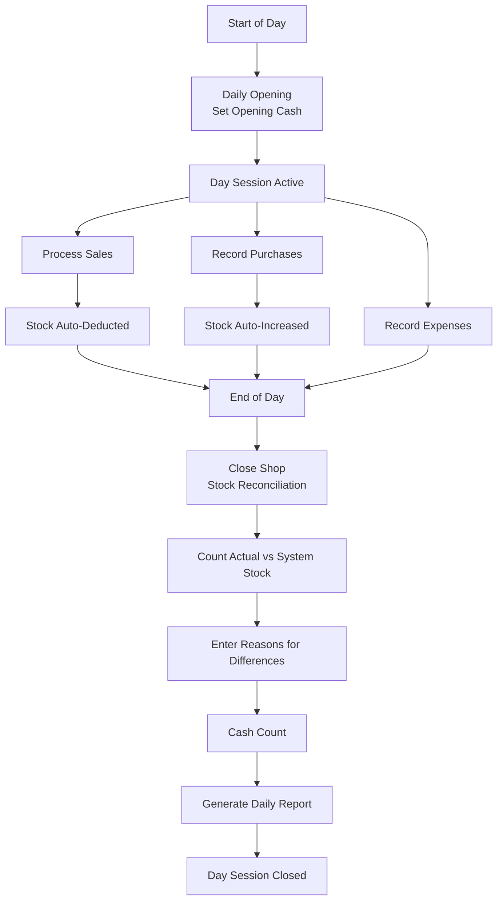
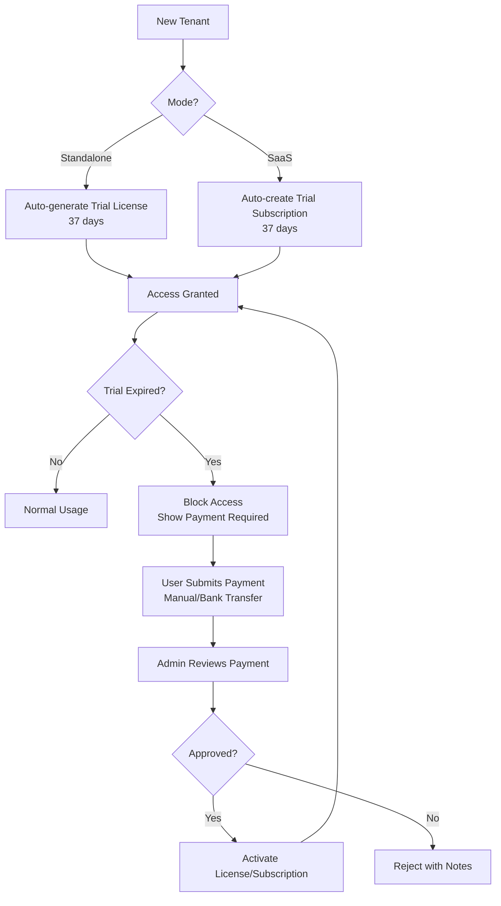
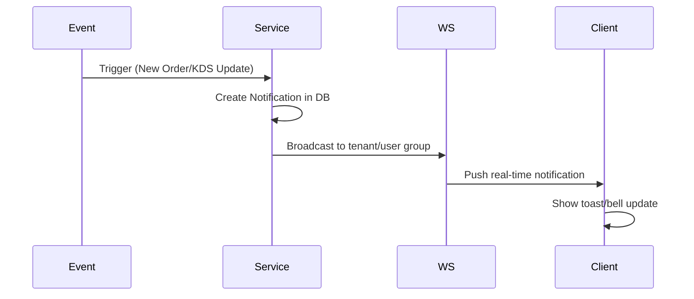
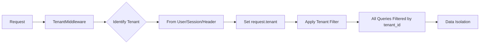

# Restaurant POS System - Flow Diagram

## 1. System Architecture Overview



## 2. User Authentication Flow



## 3. POS Order Flow



## 4. Kitchen Display System (KDS) Flow



## 5. Purchase & Inventory Flow

```mermaid
flowchart TD
    A[Create Purchase Order] --> B[Add Items with Quantity/Price]
    B --> C[Save as Pending]
    C --> D[Receive Goods - GRN]
    D --> E[API: POST /api/purchases/{id}/receive/]
    E --> F[Increase Stock]
    F --> G[Create Stock Movement]
    G --> H[Update Purchase Status: received]
    H --> I[Stock Available for Sales]
```

## 6. Daily Operations Flow



## 7. License & Subscription Flow



## 8. Notification Flow



## 9. Multi-Tenant Architecture



## Platform Support

| Platform | Technology | Status | Notes |
|----------|-----------|--------|-------|
| Web | React + Vite + TypeScript | ✅ Complete | Primary platform |
| Desktop | Electron | ✅ Complete | Native GUI, Menu, Tray, EXE build ready |
| Mobile | React Native + Expo | ✅ Complete | APK build ready, Scanner, Notifications |
| Tablet | Responsive Web | ✅ Complete | Works via web app |

## Key Features Summary

- **POS**: Order management, tables, cart, payments
- **Kitchen Display**: Real-time order tracking
- **Inventory**: Stock tracking, purchases, movements
- **Reports**: Sales, P&L, daily/monthly summaries
- **Multi-tenant**: SaaS + Standalone modes
- **Billing**: Trial, manual payments, license management
- **Notifications**: Real-time push notifications
- **Backup**: System & per-tenant backups
- **Modern UI**: Clean, responsive design
